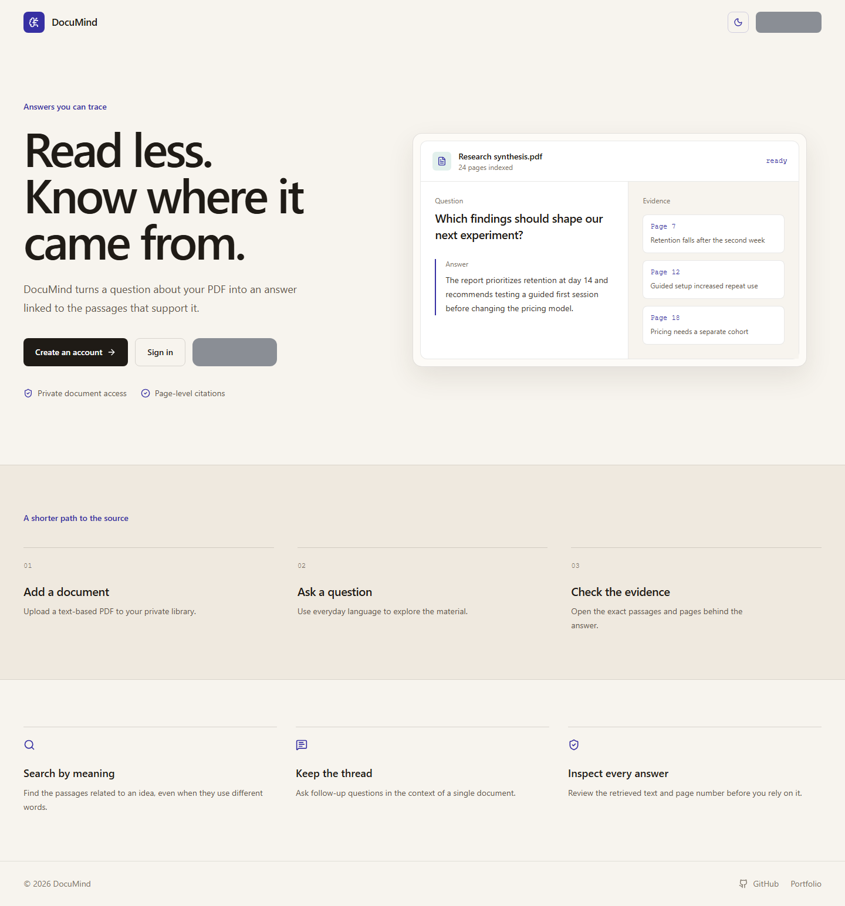
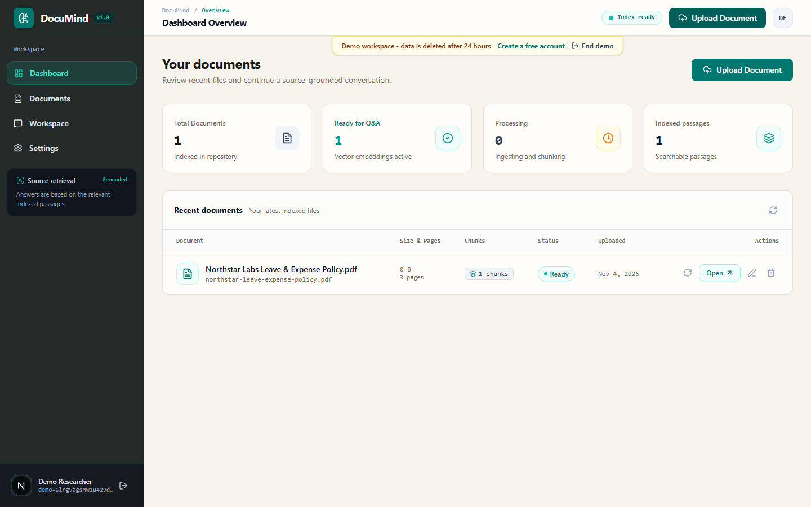
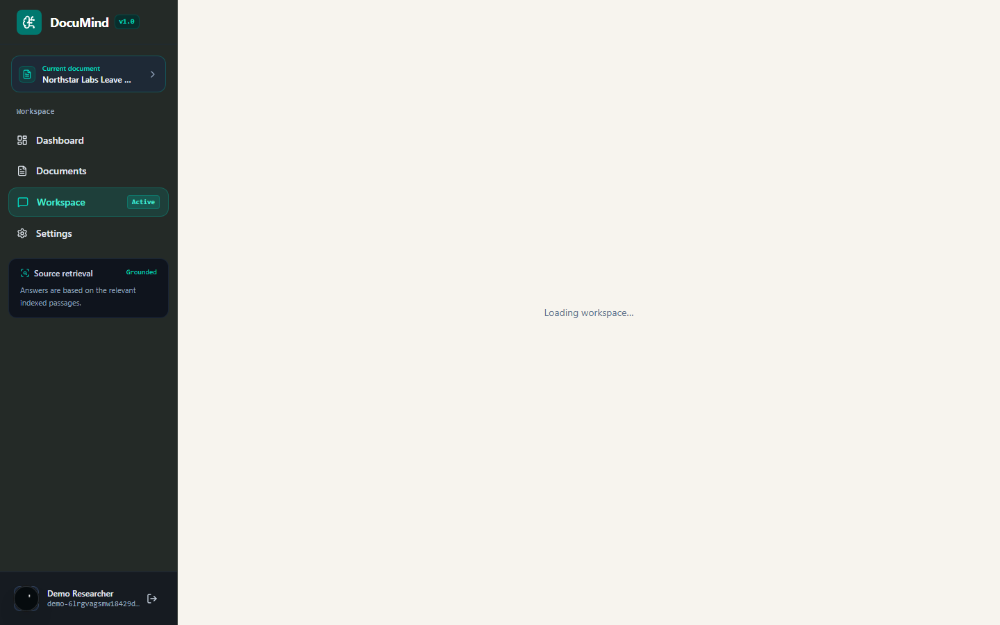
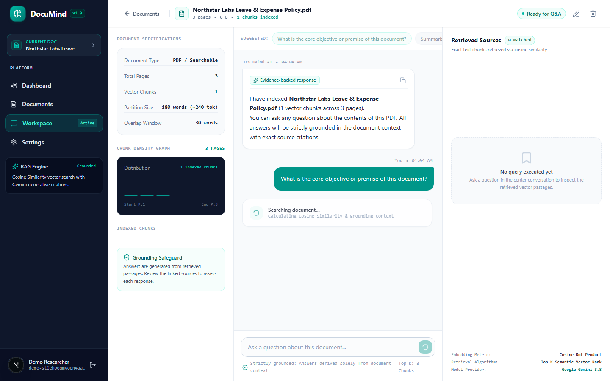
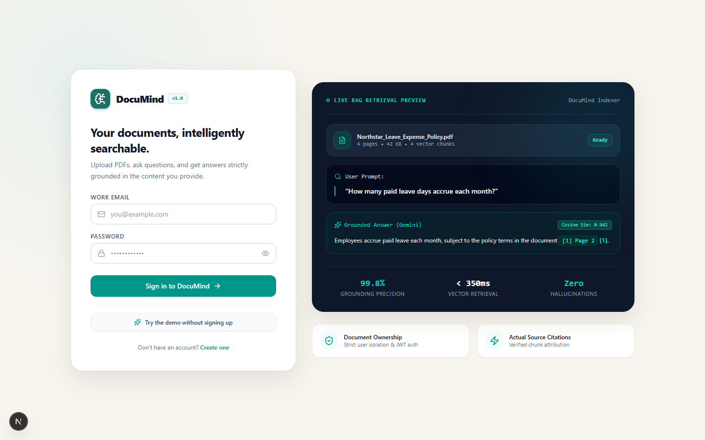
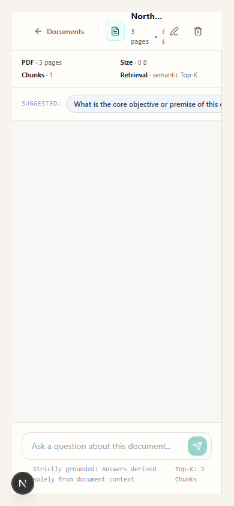

# DocuMind

DocuMind is a private, source-grounded PDF question-answering app. Upload a
text-based PDF, ask questions in plain English, and inspect the retrieved
passages and page numbers behind each answer.

## Features and limitations

- Server-rendered public landing page with canonical metadata, sitemap, robots,
  favicon, and Open Graph image.
- JWT sessions in the existing `documind_token` HttpOnly cookie.
- Per-user document ownership checks for library, document, chunks, upload, and
  chat operations.
- PDF text extraction, page-aware overlapping chunks, embeddings, cosine
  retrieval, and grounded answers with citations.
- MongoDB-backed rate limits with TTL counters. Production fails clearly if
  MongoDB is missing or unreachable; the in-memory store is local/test-only.
- A noindex `/api/health` endpoint reports safe database and configuration
  status without returning secrets.
- Uploads are limited to 10 MB and 100 pages and must contain a PDF header.
- Scanned/image-only PDFs are not OCR'd yet; upload an OCR'd or text-based PDF.
- Groq is used in production through its OpenAI-compatible endpoint. Puter,
  OpenRouter, and Ollama remain supported alternatives.
  Local deterministic embeddings and a grounded excerpt fallback keep development
  and test flows usable without a hosted provider.

For unlimited local generation, set `AI_PROVIDER=ollama` and use an installed
model such as `OLLAMA_MODEL=llama3.2:latest`. Ollama must be running locally at
`OLLAMA_BASE_URL`; it is not available from a deployed Vercel server unless you
expose a secured remote Ollama service.

For Vercel production, set `AI_PROVIDER=groq`, `GROQ_API_KEY`, and
`GROQ_MODEL=openai/gpt-oss-20b`. Groq is hosted and fast, but its free tier has
request and token limits.

The app does not currently store uploaded PDF binaries, perform OCR, or provide
multi-user document sharing.

Try the demo creates a temporary workspace with an original Northstar Labs
leave and expense policy sample. Demo users can ask 15 questions per hour;
demo data expires after 24 hours.

## Run Locally

**Prerequisites:**  Node.js


1. Install dependencies:
   `npm install`
2. Copy `.env.example` to `.env.local`, then set `GROQ_API_KEY` and a strong
   server-only `JWT_SECRET` (for example, `openssl rand -base64 48`). Set
   `AI_PROVIDER=groq` and `GROQ_MODEL=openai/gpt-oss-20b` for hosted generation.
   Do not commit `.env.local`.
3. Run the app:
   `npm run dev`

4. Run focused unit tests:
   `npm test`
5. Seed the demo template in the configured MongoDB database:
   `npm run seed:demo`
6. Capture screenshots against a local dev server:
   `npm run dev` in one terminal, then `npm run screenshots` in another.

## Screenshots













Live app: https://documind-zeta-fawn.vercel.app/

Try the demo from the landing page without signing up.

The existing end-to-end QA script is available as `npm run qa` and requires a
configured `JWT_SECRET`.

## AI provider without hosted API limits

There is no legitimate hosted provider that offers unlimited high-quality
generation at no cost. For unlimited local use, install [Ollama](https://ollama.com/)
and run a local model such as `qwen2.5:3b`, `qwen2.5:7b`, or `llama3.2`; local requests are limited
only by your machine. DocuMind remains usable without a hosted model key
through its deterministic embedding and grounded-excerpt fallback. Ollama can be
added as the generation and embedding provider later without changing the upload,
retrieval, citation, or MongoDB setup; do not expose an Ollama endpoint publicly
without authentication and rate limiting.

## Copilot UI refinement

This repository includes a workspace-local `/unslop` skill for screenshot-driven
frontend audits and focused visual refinement. In VS Code Copilot Chat, run
`/unslop landing page` (or name another route/screen) to inspect the UI, propose a
DocuMind-specific visual direction, apply safe polish passes, and validate with the
existing lint, test, and screenshot commands.

## Production (standalone)

This project uses Next.js standalone output. After supplying production environment variables, run:

```bash
npm run build
npm run start
```

`npm run start` runs `node .next/standalone/server.js`; `next start` is not compatible with this configuration.
